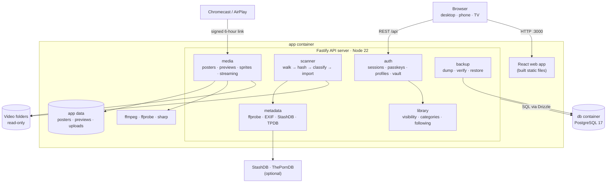
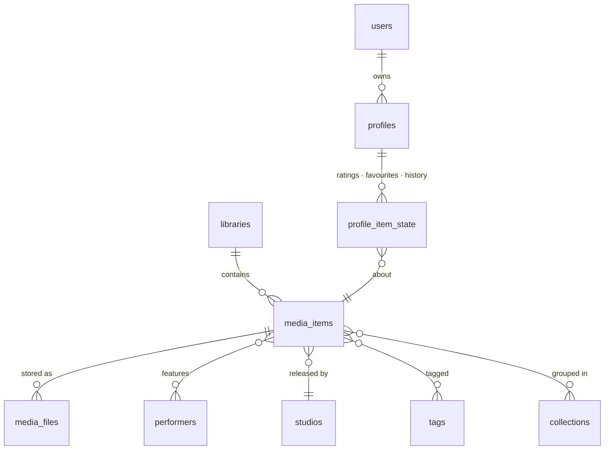

# Arc Light architecture

How the code is put together. For what the app does, see the
[README](../README.md). For how to set up, test and submit a change, see
[CONTRIBUTING.md](../CONTRIBUTING.md).

## Overview

Arc Light is a TypeScript monorepo with two apps. A **Fastify API server**
(which also serves the built web app) and a **PostgreSQL** database run as two
Docker containers. The user's video folders are mounted into the server
read-only.



## Repository layout

```
apps/
  server/
    src/app.ts          Entry point: migrations, seeding, schedules, listen
    src/buildApp.ts     Builds the Fastify app and registers every route
    src/api/            HTTP routes, one file per feature (xxxRoutes(app))
    src/auth/           Guard, sessions, passwords, passkeys, profiles, vault, cast links
    src/scanner/        Folder walk, hashing, filename parsing, series, scan schedule
    src/media/          Posters, previews, seek sprites, thumbnails, streaming, subtitles
    src/metadata/       ffprobe, photo EXIF, StashDB and ThePornDB clients
    src/library/        Visibility rules, categories, following, affinity, cleanup
    src/collections/    Rule compiler for smart collections
    src/backup/         Create, verify, restore, schedule
    src/activity/       Activity log
    src/net/            Local network guard
    src/db/             Drizzle schema, migrations, seed data
    src/test/           Test harness and fixtures
  web/
    src/main.tsx        Entry point
    src/router.tsx      Every route (TanStack Router)
    src/pages/          One component per page
    src/components/     Shared UI: player, grids, cards, editors, settings sections
    src/lib/            API hooks (*Api.ts), query keys, and pure logic with tests
docker/                 docker-compose.yml (production), docker-compose.dev.yml (overrides)
scripts/                Icon generation, restore helper
```

## Startup

`src/app.ts` does everything that changes state on boot, in this order:

1. Warns if a previous restore didn't finish.
2. Runs database migrations.
3. Seeds default data and categories.
4. Deletes expired sessions.
5. Marks any scan that was running when the process stopped as failed.
6. Starts the scan schedule and the backup schedule.
7. Builds the app (`buildApp.ts`) and listens on port 3000.

`buildApp.ts` only wires up routes. That's why tests can build the same server
without a schedule or seed running underneath them.

Any uncaught error logs the cause and exits the process. Docker's
`restart: unless-stopped` brings it back clean.

## How a request is handled

```
request
  → LAN guard      refuses requests from other devices unless local network access is on
  → auth guard     needs a session, except for PUBLIC_API_PATHS
                   refuses state-changing requests from untrusted origins
                   allows cast streams with a valid signed token
  → profile        attaches the current user and profile to the request
  → owner check    refuses OWNER_ONLY_ROUTES for non-owner profiles
  → route handler  filters by profile and visibility, then queries Drizzle
```

- **Sessions** are stored on the server and sent as an HTTP-only, SameSite=Lax
  cookie.
- **Touch ID and passkeys** use WebAuthn (SimpleWebAuthn). Allowed origins
  come from `WEBAUTHN_ORIGIN`. The same list decides which origins may send
  state-changing requests.
- **The route lists are fixed and tested.** `PUBLIC_API_PATHS` lives in
  `auth/guard.ts`, and `OWNER_ONLY_ROUTES` and `PROFILE_ROUTES` live in
  `auth/ownerRoutes.ts`. Tests check that every route is accounted for, so
  adding one is always a deliberate decision.
- **The LAN guard decides from the address the client typed (the Host
  header), not from its IP.** Under Docker, every request arrives from the
  bridge gateway. It's a convenience gate, not a security boundary.

## Visibility

Every query that returns media goes through `library/visibility.ts`. An item
is hidden when any of these is true:

| Reason | Where it comes from |
|---|---|
| Its folder is no longer scanned | `media_items.in_scope` is false |
| Its file is gone from disk | `media_items.missing_since` is set |
| It's a video still waiting in the Inbox | `media_items.triaged_at` is empty |
| It's in this profile's locked vault | `profile_item_state` plus the vault unlock |

Lists use `visibleItems(profileId)`. Routes that look up a single item use
`itemReachable(request, id)` and return 404 when it's false, so a hidden item
can't be told apart from one that doesn't exist. `api/hiddenLeaks.test.ts`
covers every endpoint that returns media.

Missing items aren't deleted. They keep their tags, performers and history,
and come back if the file reappears with the same hash. The missing-videos
manager is the one screen that asks for them directly.

## Scanning

`scanner/pipeline.ts`, started from the Rescan button or by
`scanner/schedule.ts`:

1. Creates a `scan_jobs` row (running → completed or failed).
2. Walks each library root (`walk.ts`).
3. Hashes each file's contents (`hash.ts`). A known hash at a new path is a
   moved or renamed file, so the existing item keeps its data.
4. Reads performers, studio, date, title and series from the path and filename
   (`classify.ts`, `performerNames.ts`, `series.ts`).
5. Probes the video with ffprobe for duration and streams.
6. Adds new items to the Inbox (not yet triaged).
7. Sets `missing_since` on items whose files weren't found.
8. Generates poster frames and preview clips with ffmpeg.

Only one scan runs at a time. **Fields the scanner fills in track where their
value came from** (`title_source`, `series_source` and others). Once a user
edits a field, the scanner stops overwriting it.

## Media and playback

- **Direct streaming** (`media/streamer.ts`) serves browser-compatible files
  from disk with HTTP range requests (`206 Partial Content`).
- **On-demand playback** (`media/transcode.ts`) starts FFmpeg for videos whose
  container, video codec or audio codec is not browser-compatible. It
  advertises a full HLS VOD playlist and encodes each four-second segment only
  when requested, so seeking can jump directly to an ungenerated segment.
  Segments are written to a temporary directory, served only to the profile
  that started the session, and cached up to 256 MiB per session. Idle sessions
  expire after ten minutes; stale directories are swept at startup and
  periodically. At most two sessions and two FFmpeg encoders run concurrently.
  The source library remains read-only.
- **Generated files** live in `APP_DATA_DIR`: poster frames, hover preview
  clips, seek-bar sprite sheets (`scrubSprite.ts`) and thumbnails. They're a
  cache, left out of backups and rebuilt by a scan.
- **Uploads** (performer images, custom covers) also live in `APP_DATA_DIR`,
  and *are* included in backups.
- **Subtitles** are `.srt` or `.vtt` files placed next to the video.
- **Casting** (`auth/castTokens.ts`) signs a URL with an HMAC for one item. It
  expires after six hours, so a TV can stream that one video without a
  session.

## Outside services

Both are off unless their API key is set, and both run only when the user asks.

- **StashDB** (`metadata/stashdb.ts`): cast, studio, tags and descriptions.
- **ThePornDB** (`metadata/tpdb.ts`): named position markers for the seek bar.
  Only the video's studio, release date and title are sent. The match is
  stored on the item (`tpdb_scene_id`, `tpdb_checked_at`), so each video is
  looked up only once.

## Data model

The main tables. The library data is shared. Per-profile tables keep each
person's ratings, history and follows separate.



**Shared library tables:** `libraries`, `library_roots`, `media_items`,
`media_files`, `media_item_types`, `performers`, `studios`, `tags`,
`tag_parents`, `series`, `collections`, `collection_items`, `categories`,
`albums`, `media_item_markers`, `scan_jobs`, `activity_events`,
`app_settings`.

**Account tables:** `users`, `sessions`, `webauthn_credentials`, `profiles`.

**Per-profile tables:** `profile_item_state`, `profile_performer_state`,
`profile_studio_state`, `profile_settings`, `playback_states`, `watch_log`,
`playback_heatmap`, `bookmarks`, `o_events`.

The schema lives in `apps/server/src/db/schema.ts`. Migrations are SQL files in
`src/db/migrations/`, generated by drizzle-kit and applied on boot.

## Backups

- **What's included.** `backup/create.ts` writes one `.tar.gz` file holding a
  `pg_dump` of the whole database plus the uploads folder.
- **When it runs.** On a schedule (`backup/schedule.ts`), and on demand from
  Settings.
- **Checking a backup.** `verify.ts` checks an archive before you rely on it.
- **Restoring.** `restore.ts` first takes a safety backup. It then writes a
  marker file and applies the dump in one transaction. Finally it swaps in the
  uploads and deletes the marker. If the marker is still there on the next
  boot, the restore didn't finish, and the server warns about it.
- **Version check.** Archives from a newer version of Arc Light are refused.
- **Paths.** Backups go to `BACKUP_DIR`, which is the only writable bind mount
  on the host.

## Web app

- **Routing:** TanStack Router, defined in `src/router.tsx`.
- **Data:** TanStack Query. Each feature has a `src/lib/xxxApi.ts` with its
  query and mutation hooks. Query keys come from `lib/queryKeys.ts`, so
  invalidation stays consistent.
- **Long lists** use TanStack Virtual.
- **Styling:** Tailwind CSS 4. Appearance settings sync per profile.
- **Privacy in the UI:** discreet mode blurs images, and lock-on-open shows a
  gate before anything loads. These are visual protections. The server is what
  enforces privacy.
- **Phones:** the web app is the mobile app, so layouts are responsive.

## Tech stack

| Layer | Technology |
|---|---|
| Server | Node 22, TypeScript, Fastify 5, Drizzle ORM, PostgreSQL 17 |
| Web | React 19, Vite, TanStack Router, Query and Virtual, Tailwind CSS 4 |
| Media | ffmpeg / ffprobe, sharp, exifr |
| Auth | Server-side sessions, SimpleWebAuthn |
| Testing | Vitest, Testing Library, real PostgreSQL for server tests |
| Lint | oxlint (web) |
| Packaging | Docker Compose, wrapped by a Makefile |
| CI | GitHub Actions: web build, lint and test; server type-check and test; Docker build |

## Key decisions

| Decision | Why |
|---|---|
| Library mounted read-only | The user's files are the source of truth. The app can't damage them. |
| Direct play plus on-demand transcode | Compatible files stay cheap to play; unsupported containers/codecs can be converted without changing originals. |
| Content hashing | Moving or renaming files doesn't lose ratings, tags or history. |
| Server-side visibility | Hidden items are filtered before they reach the browser, not just hidden in the UI. |
| Fixed, tested route lists | A new route can't become public or open to every profile by accident. |
| Real Postgres in tests | Production bugs here were ones a mock would have missed. |
| One account, many profiles | Built for one household, not as a multi-user service. |
